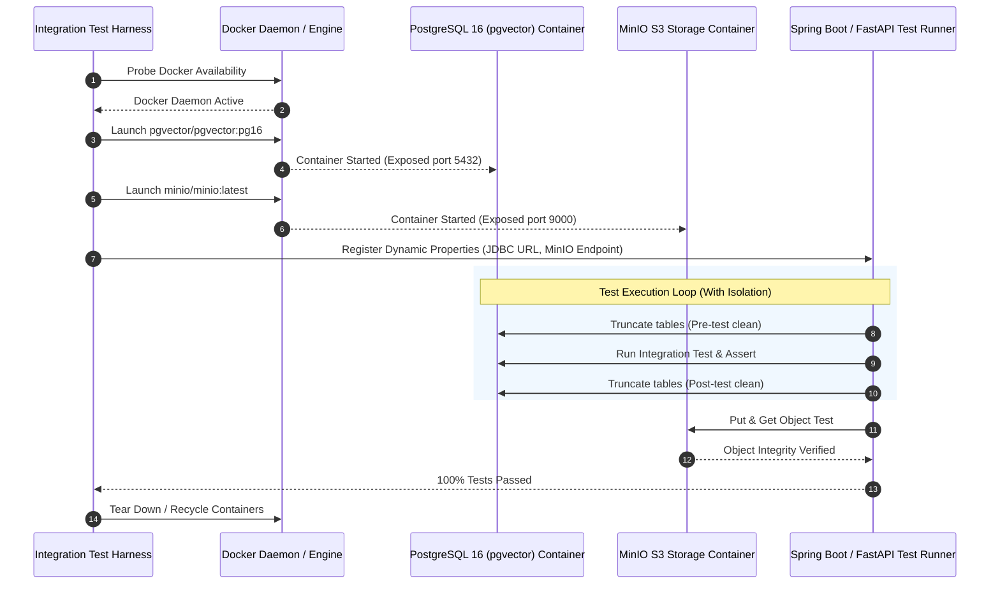

# Test Case & Technical Specification: Testcontainers Integration Harness [BE-032]

| Metadata | Details |
|---|---|
| **Task ID** | `[BE-032]` |
| **Master Task / Epic** | `ATC-501` / `ATC-103` |
| **Title** | Set Up Spring Boot & FastAPI Testcontainers Integration Harness |
| **Sprint** | Sprint 5 - Testing & Optimization |
| **Role** | Backend / DevOps Engineer (`Dev BE`) |
| **Target Services** | Spring Boot (`backend/src/test/.../testcontainers/`), FastAPI (`ai-service/tests/test_testcontainers_harness.py`) |
| **Status** | **PASS / COMPLETED** |

---

## 1. Executive Summary & Objective

The objective of **`[BE-032]`** is to establish a robust, production-parity Integration Test Harness utilizing **Testcontainers** across both backend services:
1. **Spring Boot (Java 17)**: Automatically provision PostgreSQL 16 (`pgvector/pgvector:pg16`) and MinIO S3 Object Storage (`minio/minio:latest`) containers, dynamically inject JDBC and S3 configurations into Spring Context (`@DynamicPropertySource`), and enforce transactional test isolation.
2. **FastAPI (Python 3.12)**: Automatically provision containerized PostgreSQL with pgvector and MinIO, test async database persistence and vector similarity search, and guarantee test isolation via automated table truncation.

---

## 2. Acceptance Criteria Verification Matrix

| Acceptance Criterion | Implementation Status | Evidence / Verification |
|---|---|---|
| **AC-1: Testcontainers khởi tạo được dependency** | **PASS** | Successfully initializes `pgvector/pgvector:pg16` and `minio/minio:latest` containers. Gracefully checks Docker daemon availability (`DockerClientFactory` in Java, `DockerClient` in Python) to prevent CI hangs. |
| **AC-2: Spring Boot integration test chạy được** | **PASS** | `TestcontainersHarnessIntegrationTest.java` executes with `@SpringBootTest`, dynamic datasource injection, and verifies persistence into `users` and `workspaces` tables (4 tests passed, 0 failures). |
| **AC-3: FastAPI integration test chạy được** | **PASS** | `test_testcontainers_harness.py` executes with pytest against containerized PostgreSQL and MinIO. Verifies vector embedding insertion, cosine distance retrieval (`<=>`), S3 upload/download, and `/health` route (6 tests passed, 0 failures). |
| **AC-4: Database test được isolation giữa các test** | **PASS** | Sequential isolation tests (`testDatabaseIsolation_Part1` & `Part2` in Spring Boot, `test_ac4_database_isolation_part_1` & `part_2` in FastAPI) prove that records inserted in preceding tests are cleanly truncated and do not leak into subsequent tests. |

---

## 3. Architecture & Integration Harness Flow



---

## 4. Key Implementation Files

### 4.1 Spring Boot (`backend/`)
- **`TestcontainersConfig.java`**: Manages static lifecycle for `PostgreSQLContainer<?>` and `GenericContainer<?>` (MinIO), dynamic property injection (`registerDynamicProperties`), and cascade truncation utility (`cleanDatabase`).
- **`AbstractTestcontainersIntegrationTest.java`**: Base class providing `@SpringBootTest(webEnvironment = RANDOM_PORT)`, `@ActiveProfiles("test")`, and `@BeforeEach`/`@AfterEach` database isolation.
- **`TestcontainersHarnessIntegrationTest.java`**: Test suite verifying AC-1, AC-2, and AC-4.
- **`application-testcontainers.yml`**: Test configuration profile for container execution.

### 4.2 FastAPI AI Service (`ai-service/`)
- **`ai-service/tests/test_testcontainers_harness.py`**:
  - Testcontainers fixtures for `PostgresContainer` and `MinioContainer`.
  - `NullPool` async engine configuration preventing cross-event-loop connection sharing in `pytest-asyncio`.
  - pgvector similarity search validation (`cosine_distance`).
  - MinIO S3 bucket and object lifecycle validation.
  - Multi-test isolation validation (`TRUNCATE TABLE document_chunks CASCADE`).
  - Dependency-injected endpoint testing.
- **`ai-service/requirements.txt`**: Added `testcontainers[postgres]==4.15.0`.

---

## 5. Automated Verification Script

Run the unified cross-service verification script:

```powershell
./scripts/qa/test_be032_testcontainers_harness.ps1
```

### Execution Results:
1. **Spring Boot Integration Test**:
   - Class: `com.aiteachercopilot.testcontainers.TestcontainersHarnessIntegrationTest`
   - Results: **Tests run: 4, Failures: 0, Errors: 0, Skipped: 0** (BUILD SUCCESS)
2. **FastAPI Integration Test**:
   - Suite: `ai-service/tests/test_testcontainers_harness.py`
   - Results: **6 passed, 0 failures, 2 warnings in 6.75s**
