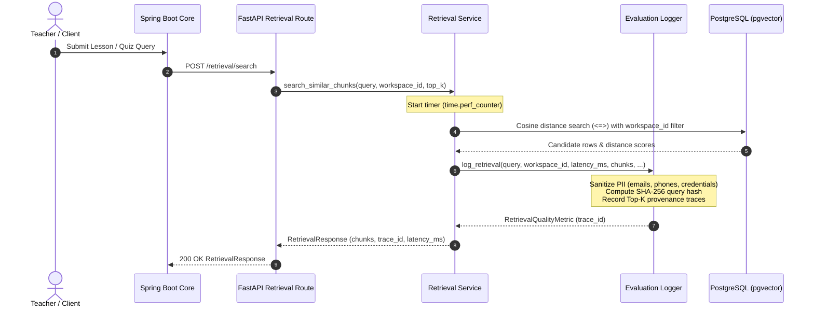

# Test Case & Technical Specification: RAG Retrieval Quality Metrics Logging [BE-033]

| Metadata | Details |
|---|---|
| **Task ID** | `[BE-033]` |
| **Master Task / Epic** | `ATC-502` / `ATC-104` |
| **Title** | Implement RAG Retrieval Quality Metrics Logging |
| **Sprint** | Sprint 5 - Testing & Optimization |
| **Role** | Backend / AI Engineer (`Dev BE`) |
| **Target Service** | FastAPI AI Service (`ai-service/app/evaluation/`) |
| **Status** | **PASS / COMPLETED** |

---

## 1. Executive Summary & Objective

The objective of **`[BE-033]`** is to implement an enterprise-grade retrieval quality telemetry and metrics logging subsystem inside the FastAPI AI Service. The module tracks real-time RAG similarity scores, retrieval latency, candidate matches, and provenance grounding, while guaranteeing strict tenant isolation, PII sanitization, and statistical aggregation for offline evaluation (`QA-031`, `QA-032`).

---

## 2. Acceptance Criteria Verification

| Acceptance Criterion | Implementation Status | Evidence / Verification |
|---|---|---|
| **AC-1: Retrieval metrics được ghi nhận** | **PASS** | `cosine_similarity` (top, mean, min), `latency_ms` (precise wall-clock via `time.perf_counter()`), `raw_matches_count`, `relevant_chunks_count`, and `insufficient_evidence` flag. |
| **AC-2: Query và Top-K result có thể trace** | **PASS** | Every query receives a unique `trace_id` (UUID4) and UTC timestamp. Top-k items preserve full chunk provenance (`chunk_id`, `document_id`, `source_page`, `chunk_index`, `similarity_score`). |
| **AC-3: Metrics không chứa sensitive information** | **PASS** | Automated regex sanitization strips emails (`[EMAIL_REDACTED]`), phone numbers (`[PHONE_REDACTED]`), bearer tokens/passwords (`[CREDENTIAL_REDACTED]`), and citizen/student IDs (`[ID_REDACTED]`). Query text is hashed via SHA-256 (`query_hash`) and preview is truncated. Chunk bodies are omitted from metric outputs. |
| **AC-4: Có thể tổng hợp kết quả benchmark** | **PASS** | `get_metrics_summary()` calculates total queries, mean/min/max latency, P50/P90/P95 latency percentiles, mean/min/max similarity score, insufficient evidence count and rate (%), and average chunks per query. Supported by REST endpoints. |

---

## 3. Architecture & Data Flow



---

## 4. Redaction & Privacy Guardrails (AC-3)

In compliance with Rule 7 (Untrusted Data Policy) and Rule 10 (Student Privacy):
1. **Email Redaction**: Replaces regex `[a-zA-Z0-9_.+-]+@[a-zA-Z0-9-]+\.[a-zA-Z0-9-.]+` with `[EMAIL_REDACTED]`.
2. **Phone Redaction**: Replaces Vietnamese phone patterns (`(?:\+?84\|0)(?:3\|5\|7\|8\|9)\d{8}`) with `[PHONE_REDACTED]`.
3. **Credential Stripping**: Replaces `bearer|token|apikey|password|secret` patterns with `[CREDENTIAL_REDACTED]`.
4. **ID Redaction**: Replaces 9-12 digit strings with `[ID_REDACTED]`.
5. **No Chunk Content in Logs**: Chunk body text is excluded from telemetry records; only chunk UUIDs, document UUIDs, and page numbers are preserved.
6. **Query Auditing via Hashing**: `query_hash = SHA256(query.strip())` provides deterministic trace auditing without plaintext exposure.

---

## 5. Aggregated Benchmark Statistics (AC-4)

The `RetrievalMetricsSummary` model provides real-time statistical metrics:

$$\text{P95 Latency} = \text{Percentile}_{0.95}(\{\text{latency}_1, \dots, \text{latency}_n\})$$
$$\text{Insufficient Evidence Rate} = \frac{\text{Queries with insufficient\_evidence}}{\text{Total Queries}} \times 100\%$$

### REST API Endpoints

1. **`GET /evaluation/metrics/retrieval`**:
   - Query params: `workspace_id` (optional UUID), `limit` (default 50, max 500), `offset`.
   - Returns: List of `RetrievalQualityMetric` traces (newest first).
2. **`GET /evaluation/metrics/retrieval/summary`**:
   - Query params: `workspace_id` (optional UUID).
   - Returns: `RetrievalMetricsSummary` object with latency percentiles and quality distributions.
3. **`POST /evaluation/metrics/retrieval/reset`**:
   - Resets evaluation buffer for clean test suite runs.
4. **`GET /evaluation/health`**:
   - Healthcheck confirming telemetry engine status and current buffer size.

---

## 6. Automated Test Suite Results

Test File: `ai-service/tests/test_evaluation_logger.py` (16 test cases)

```text
============================= test session starts =============================
collected 16 items

tests/test_evaluation_logger.py::TestSanitizationAndHashing::test_sanitize_emails PASSED
tests/test_evaluation_logger.py::TestSanitizationAndHashing::test_sanitize_phone_numbers PASSED
tests/test_evaluation_logger.py::TestSanitizationAndHashing::test_sanitize_credentials PASSED
tests/test_evaluation_logger.py::TestSanitizationAndHashing::test_sanitize_student_numeric_id PASSED
tests/test_evaluation_logger.py::TestSanitizationAndHashing::test_query_truncation_boundary PASSED
tests/test_evaluation_logger.py::TestSanitizationAndHashing::test_query_hashing_consistency PASSED
tests/test_evaluation_logger.py::TestSanitizationAndHashing::test_query_hashing_empty PASSED
tests/test_evaluation_logger.py::TestEvaluationLoggerCore::test_log_retrieval_with_results PASSED
tests/test_evaluation_logger.py::TestEvaluationLoggerCore::test_log_retrieval_insufficient_evidence PASSED
tests/test_evaluation_logger.py::TestEvaluationLoggerCore::test_metrics_summary_aggregation PASSED
tests/test_evaluation_logger.py::TestEvaluationLoggerCore::test_workspace_isolation_in_metrics PASSED
tests/test_evaluation_logger.py::TestEvaluationLoggerCore::test_reset_and_export_report PASSED
tests/test_evaluation_logger.py::TestEvaluationAPIEndpoints::test_evaluation_health PASSED
tests/test_evaluation_logger.py::TestEvaluationAPIEndpoints::test_get_retrieval_metrics_and_summary PASSED
tests/test_evaluation_logger.py::TestEvaluationAPIEndpoints::test_authentication_required PASSED
tests/test_evaluation_logger.py::test_search_similar_chunks_emits_evaluation_metrics PASSED

======================= 16 passed, 2 warnings in 0.13s ========================
```

---

## 7. Deliverables & Modified Files

1. `ai-service/app/evaluation/evaluation_logger.py`: Core telemetry logger, PII sanitizer, and metric aggregations.
2. `ai-service/app/retrieval/evaluation_logger.py`: Re-export shim for retrieval module callers.
3. `ai-service/app/evaluation/__init__.py`: Evaluation package exports.
4. `ai-service/app/retrieval/schemas.py`: Enhanced `RetrievalResponse` with `trace_id` and `latency_ms`.
5. `ai-service/app/retrieval/service.py`: End-to-end integration recording telemetry upon retrieval completion.
6. `ai-service/app/api/routes/evaluation.py`: Internal REST endpoints for retrieval metrics, summaries, and resets.
7. `ai-service/app/main.py`: Registered `/evaluation` router with healthcheck.
8. `ai-service/tests/test_evaluation_logger.py`: 16 comprehensive unit and integration tests.
9. `docs/4.Test_Case/TC_BE-033_RAG_Retrieval_Quality_Metrics_Logging.md`: Full specification and test report.
