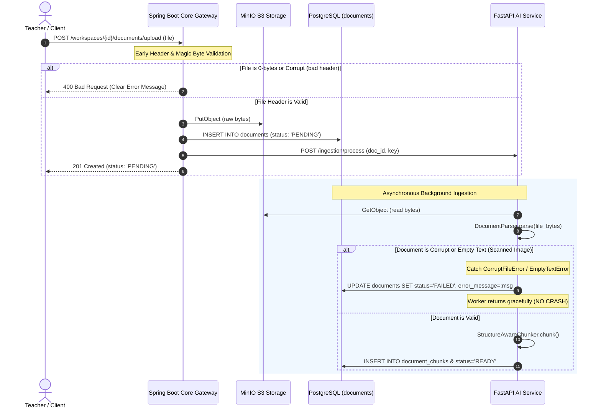

# Test Case & Technical Specification: Corrupt Files & Empty Text Handling [BE-035]

| Metadata | Details |
|---|---|
| **Task ID** | `[BE-035]` |
| **Master Task / Epic** | `ATC-504` / `ATC-111` |
| **Title** | Implement Exception Handlers for Corrupt Files & Empty Text |
| **Sprint** | Sprint 5 - Testing & Optimization |
| **Role** | Backend Engineer (`Dev BE`) |
| **Target Services** | Spring Boot (`backend/`), FastAPI (`ai-service/`) |
| **Status** | **PASS / COMPLETED** |

---

## 1. Executive Summary & Objective

The objective of **`[BE-035]`** is to implement resilient, production-grade exception handling across the end-to-end document upload and ingestion pipeline for unprocessable documents:
1. **Corrupt File Detection**: Detect corrupted binary streams, invalid file headers (`%PDF`, `PK\x03\x04` ZIP OpenXML), password-protected/encrypted PDFs, and disguised binary text files before storage and processing.
2. **Empty Text Handling**: Gracefully intercept documents with zero processable text (e.g. image-only PDF scans without OCR, blank pages, or empty files) instead of creating empty index chunks.
3. **Clear API Error Responses**: Return localized, human-readable error messages (HTTP 400 Bad Request / HTTP 422 Unprocessable Entity) so teachers understand immediately why a document failed.
4. **Ingestion Service Resilience**: Ensure background processing failures never crash worker threads or the FastAPI ingestion service, automatically updating document status to `FAILED` with descriptive `error_message` in PostgreSQL.

---

## 2. Acceptance Criteria Verification Matrix

| Acceptance Criterion | Implementation Status | Evidence / Verification |
|---|---|---|
| **AC-1: Corrupt file được phát hiện** | **PASS** | Validates magic bytes at upload (`DocumentService.validateFileIntegrity`) and inside parsing (`DocumentParser`). Throws `CorruptFileException` (Java) and `CorruptFileError` (Python) for missing `%PDF`, broken ZIP, encrypted PDFs, or corrupt streams. |
| **AC-2: Empty text được xử lý** | **PASS** | Rejects 0-byte files with `EmptyFileException`. `DocumentParser.parse` checks extracted text after multi-page traversal; if empty/whitespace, raises `EmptyTextError` and marks document `FAILED`. |
| **AC-3: API trả lỗi rõ ràng** | **PASS** | `GlobalExceptionHandler.java` catches `CorruptFileException` and `EmptyFileException` returning HTTP 400 with descriptive error messages. `POST /ingestion/validate` returns structured JSON diagnostic reporting `valid: false`, `status: CORRUPT_FILE` / `EMPTY_TEXT`. |
| **AC-4: Không làm crash ingestion service** | **PASS** | `process_document_pipeline` wraps all stages in guarded try-except blocks. Errors are logged with `structlog` and persisted to DB (`processing_status = 'FAILED'`, `error_message = ...`) without raising unhandled exceptions into the ASGI/background runner. |

---

## 3. Architecture & Exception Handling Flow



---

## 4. Key Implementation Files

### 4.1 Spring Boot (`backend/`)
- **`V5__add_document_error_message.sql`**: Flyway migration adding `error_message VARCHAR(1000)` column to `documents` table.
- **`Document.java` & `DocumentDto.java`**: Added `errorMessage` field to entity and DTO responses (`ListResponse`, `UploadResponse`).
- **`CorruptFileException.java` & `EmptyFileException.java`**: Domain exceptions for file corruption and empty text.
- **`GlobalExceptionHandler.java`**: Added exception handlers returning HTTP 400 Bad Request with localized messages.
- **`DocumentService.java`**: Pre-upload magic bytes inspection (`validateFileIntegrity`) for PDF, DOCX, and TXT.
- **`DocumentExceptionHandlerIntegrationTest.java`**: 5 automated test cases verifying upload rejection of corrupt PDF, corrupt DOCX, 0-byte file, null-byte text, and retrieval of `FAILED` error message.

### 4.2 FastAPI AI Service (`ai-service/`)
- **`app/ingestion/exceptions.py`**: Defined `CorruptFileError`, `EmptyTextError`, `UnsupportedFileFormatError`, and `DocumentIngestionError`.
- **`app/ingestion/parser.py`**: Multi-format parser with signature validation (`PDF_MAGIC_BYTES`, `DOCX_MAGIC_BYTES`), encryption check, and extractable text verification.
- **`app/ingestion/service.py`**: Safe pipeline execution updating DB `error_message` upon error without crashing worker process (`AC-4`).
- **`app/api/routes/ingestion.py`**: Added `POST /ingestion/validate` synchronous inspection endpoint.
- **`app/main.py`**: Added global FastAPI exception handlers for `CorruptFileError` and `EmptyTextError`.
- **`tests/test_corrupt_files_empty_text.py`**: 14 automated unit & integration test cases covering all error conditions.

---

## 5. Automated Verification Script

Run the unified cross-service verification script:

```powershell
./scripts/qa/test_be035_corrupt_files_empty_text.ps1
```

### Execution Results:
1. **Spring Boot Integration Test**:
   - Tests: `DocumentExceptionHandlerIntegrationTest`, `DocumentUploadIntegrationTest`
   - Results: **Tests run: 14, Failures: 0, Errors: 0, Skipped: 0** (BUILD SUCCESS)
2. **FastAPI Ingestion & Parser Test**:
   - Tests: `test_corrupt_files_empty_text.py`, `test_parser.py`
   - Results: **17 passed, 0 failures, 2 warnings in 0.35s**
