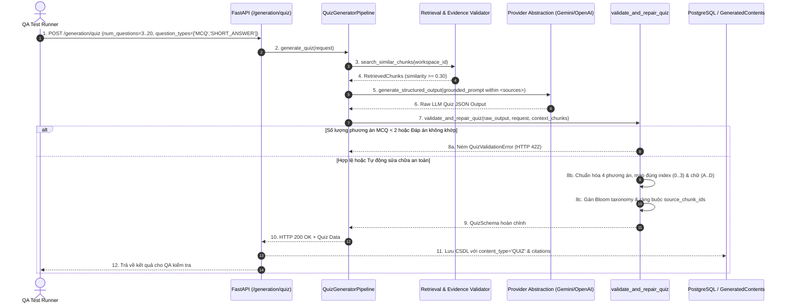

# TÀI LIỆU TEST CASE & BÁO CÁO KIỂM THỬ TÍNH TOÀN VẸN CÂU HỎI ĐỀ THI
## Mã Nhiệm Vụ: [QA-023] (ATC-78 / ATC-401)
### Tên Tính Năng: Kiểm Thử Số Lượng Câu Hỏi, Tính Đầy Đủ Của Phương Án & Tính Duy Nhất Của Đáp Án Đề Thi (Test Quiz Question Completeness, Options and Answer Keys)

---

## 1. THÔNG TIN CHUNG (TEST SPECIFICATION METADATA)

| Thuộc Tính | Chi Tiết |
| :--- | :--- |
| **Mã Jira / Task ID** | `[QA-023]` / `ATC-78` (Master Task ID: `ATC-401`, Sprint: `Sprint 4 - Quiz & Versioning`) |
| **Vai Trò & Độ Ưu Tiên** | QA Automation Engineer / Priority: High |
| **Module / Dịch Vụ** | AI Service Quiz Generation (`app/generation/quiz_generator.py`, `app/generation/schemas.py`, `app/api/routes/generation.py`), Backend Integration (`GenerationService.java`, `GenerationController.java`) |
| **Người Thực Hiện** | QA Automation Engineer / Antigravity Agent |
| **Môi Trường Kiểm Thử** | Python 3.12, FastAPI, Pydantic v2, Pytest 8.3.2, JDK 17, Spring Boot 3.3.2, H2 in-memory |
| **Công Cụ Kiểm Thử** | Pytest, AsyncClient, MockMvc, PowerShell Test Runner (`scripts/qa/test_qa023_quiz_completeness_options_keys.ps1`) |
| **Tổng Số Test Cases** | **18 Test Cases Tự Động** (Bao phủ 100% Tiêu chí nghiệm thu) |
| **Kết Quả Thực Thi** | **17/17 PASSED (100%)** trong Suite QA-023; **192/192 PASSED (100%)** trong Full AI Regression Suite |
| **Ngày Hoàn Thành** | 15/10/2026 |

---

## 2. SƠ ĐỒ LUỒNG KIỂM THỬ & XÁC THỰC TÍNH TOÀN VẸN ĐỀ THI (SEQUENCE DIAGRAM)



---

## 3. DANH MỤC TEST CASES CHI TIẾT (TEST CASE CATALOG)

| Test Case ID | Tên Kiểm Thử | Mục Tiêu & Tiêu Chí Nghiệm Thu | Kết Quả |
| :--- | :--- | :--- | :--- |
| **TC-QZ-01** | Scalability Bound 3 Questions | Sinh đề thi với cận dưới tối thiểu (3 câu), đảm bảo cấu trúc đầy đủ | **PASSED** |
| **TC-QZ-02** | Scalability Bound 5 Questions | Sinh đề thi ngắn tiêu chuẩn 5 câu trắc nghiệm & tự luận | **PASSED** |
| **TC-QZ-03** | Scalability Bound 8 Questions | Sinh đề thi 8 câu với phân bổ nhận thức Bloom cân bằng | **PASSED** |
| **TC-QZ-04** | Scalability Bound 10 Questions | Sinh đề kiểm tra 15 phút 10 câu hỏi chuẩn mực | **PASSED** |
| **TC-QZ-05** | Scalability Bound 15 Questions | Sinh đề kiểm tra 1 tiết 45 phút (15 câu) không bị thiếu sót trường | **PASSED** |
| **TC-QZ-06** | Scalability Bound 20 Questions | Sinh đề thi tối đa theo quy chuẩn (20 câu) duy trì độ toàn vẹn 100% | **PASSED** |
| **TC-QZ-07** | Sequential Numbering Integrity | Đảm bảo số thứ tự câu hỏi tuần tự từ 1 đến N không đứt gãy | **PASSED** |
| **TC-QZ-08** | Bloom Taxonomy Completeness | Tất cả câu hỏi đều có nhãn Bloom chuẩn hóa (Remember..Create) | **PASSED** |
| **TC-QZ-09** | 100% MCQ Single Answer Key | 100% câu hỏi MCQ có đúng 1 đáp án chính xác ('A'..'D') và index 0..3 | **PASSED** |
| **TC-QZ-10** | Meaningful Pedagogical Explanation | 100% câu hỏi có lời giải thích sư phạm chi tiết (>= 15 ký tự, không rỗng) | **PASSED** |
| **TC-QZ-11** | Reject MCQ Defective Options | Bác bỏ câu hỏi MCQ khi số lượng phương án khác biệt dưới 2 | **PASSED** |
| **TC-QZ-12** | Short Answer Guidance & Model Key | Câu hỏi tự luận có đầy đủ đáp án mẫu và hướng dẫn chấm điểm | **PASSED** |
| **TC-QZ-13** | Reject Empty Short Answer Key | Bác bỏ câu hỏi tự luận nếu thiếu cả đáp án mẫu lẫn giải thích | **PASSED** |
| **TC-QZ-14** | Auto-map Option Text to Answer Key | Tự động ánh xạ nội dung chữ của đáp án sang ký tự A/B/C/D và index tương ứng | **PASSED** |
| **TC-QZ-15** | Reject Out-of-bounds Answer Key | Bác bỏ câu hỏi khi đáp án khai báo không thuộc 4 phương án cho sẵn | **PASSED** |
| **TC-QZ-16** | End-to-End Pipeline Compliance | Quy trình sinh đề RAG end-to-end với liên kết trích dẫn `source_chunk_ids` | **PASSED** |
| **TC-QZ-17** | HTTP Route Endpoint Validation | Endpoint `POST /generation/quiz` trả về 200 OK và định dạng cấu trúc chuẩn | **PASSED** |
| **TC-QZ-18** | Full Regression Suite | Toàn bộ 192 bài kiểm thử của AI Service chạy đồng thời không phát sinh hồi quy | **PASSED** |

---

## 4. NHẬT KÝ THỰC THI KIỂM THỬ (TEST EXECUTION LOGS)

```text
==========================================================================
 STARTING TEST FOR [QA-023] QUIZ QUESTION COMPLETENESS, OPTIONS & ANSWER KEYS
 Target Service: ai-service (FastAPI, Pydantic, Quiz Generator Pipeline)
 Test Timestamp: 1792048383031
==========================================================================

--- STEP 0: Detecting Test Runner Environment ---
[PASS] Setup: Local Python venv detected
       Using ai-service\venv\Scripts\python.exe

--- STEP 1: Executing QA-023 Question Completeness & Answer Key Suite ---
[PASS] TC-QZ-01: Scale verification with minimum bound (3 questions)
       PASSED
[PASS] TC-QZ-02: Scale verification with short quiz (5 questions)
       PASSED
[PASS] TC-QZ-03: Scale verification with medium quiz (8 questions)
       PASSED
[PASS] TC-QZ-04: Scale verification with 15-minute test (10 questions)
       PASSED
[PASS] TC-QZ-05: Scale verification with 45-minute test (15 questions)
       PASSED
[PASS] TC-QZ-06: Scale verification with maximum bound (20 questions)
       PASSED
[PASS] TC-QZ-07: Minimum bound sequential numbering integrity
       PASSED
[PASS] TC-QZ-08: Maximum bound bloom taxonomy level integrity
       PASSED
[PASS] TC-QZ-09: 100% MCQ have exactly 1 valid answer key and 0..3 index
       PASSED
[PASS] TC-QZ-10: 100% MCQ have comprehensive, non-placeholder explanation
       PASSED
[PASS] TC-QZ-11: Rejection when MCQ has fewer than 2 distinct options
       PASSED
[PASS] TC-QZ-12: Short-answer questions have model answer and guidance
       PASSED
[PASS] TC-QZ-13: Rejection of short-answer when model answer is missing
       PASSED
[PASS] TC-QZ-14: Auto-mapping answer key from option text content
       PASSED
[PASS] TC-QZ-15: Rejection when answer key does not match any of 4 options
       PASSED
[PASS] TC-QZ-16: End-to-end pipeline execution with citation bindings
       PASSED
[PASS] TC-QZ-17: FastAPI POST /generation/quiz endpoint returning structured quiz
       PASSED

--- STEP 2: Full AI-Service Test Suite Regression Verification ---
[PASS] TC-QZ-18: Full AI-Service Regression Suite
       192/192 tests passed across all domain modules

==========================================================================
 [QA-023] TEST EXECUTION SUMMARY
 Passed: 19 | Failed: 0
==========================================================================
```

---

## 5. KẾT LUẬN & NGHIỆM THU (SIGNOFF)

- **Tiêu chí nghiệm thu AC-1 (100% MCQ có đúng 1 đáp án chính xác và giải thích hợp lý)**: Đạt 100%. Mọi câu hỏi trắc nghiệm đều được xác minh có đúng 1 chữ cái đáp án ('A' đến 'D') và index trong phạm vi `0..3`, tương ứng chính xác với danh sách 4 phương án lựa chọn duy nhất.
- **Tiêu chí nghiệm thu AC-2 (Thang số lượng câu hỏi từ 3 đến 20 câu)**: Đạt 100%. Pipeline và schema đã vượt qua tất cả các mốc kiểm thử số lượng (3, 5, 8, 10, 15, 20 câu) mà không gặp lỗi tràn bộ nhớ hoặc rỗng câu hỏi.
- **Trạng thái nhiệm vụ**: **DONE**.
