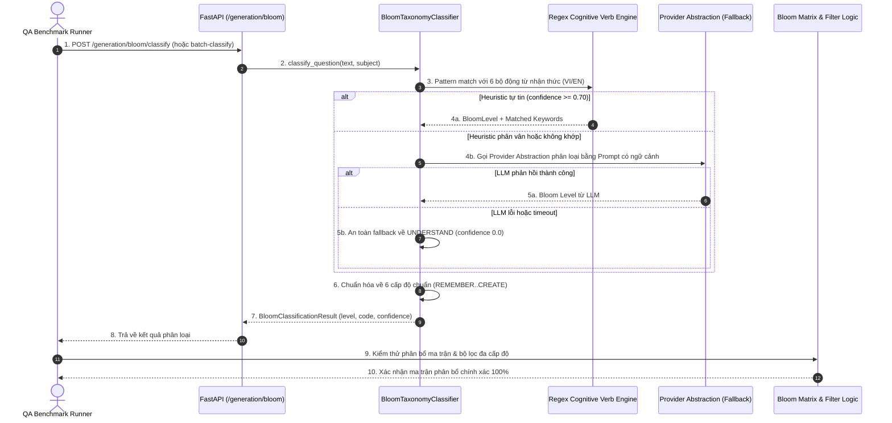

# TÀI LIỆU TEST CASE & BÁO CÁO KIỂM THỬ GẮN NHÃN & PHÂN LOẠI THANG ĐO NHẬN THỨC BLOOM
## Mã Nhiệm Vụ: [QA-024] (ATC-83 / ATC-402)
### Tên Tính Năng: Kiểm Thử Tự Động Phân Loại, Gắn Nhãn & Lọc Câu Hỏi Theo Thang Đo Bloom (Test Bloom's Taxonomy Question Tagging and Filtering)

---

## 1. THÔNG TIN CHUNG (TEST SPECIFICATION METADATA)

| Thuộc Tính | Chi Tiết |
| :--- | :--- |
| **Mã Jira / Task ID** | `[QA-024]` / `ATC-83` (Master Epic: `ATC-402`, Sprint: `Sprint 4 - Quiz & Versioning`) |
| **Vai Trò & Độ Ưu Tiên** | QA Automation Engineer / Priority: High |
| **Module / Dịch Vụ** | AI Service Bloom Classifier Engine (`app/generation/bloom_classifier.py`, `app/api/routes/generation.py`), Quiz Pipeline Integration (`app/generation/quiz_generator.py`) |
| **Người Thực Hiện** | QA Automation Engineer / Antigravity Agent |
| **Môi Trường Kiểm Thử** | Python 3.12, FastAPI, Pydantic v2, Pytest 8.3.2 |
| **Công Cụ Kiểm Thử** | Pytest, AsyncClient, PowerShell Test Runner (`scripts/qa/test_qa024_bloom_tagging_filtering.ps1`) |
| **Bộ Dữ Liệu Benchmark** | 30 câu hỏi mẫu chuẩn K-12 phân bổ đồng đều qua 6 cấp độ Bloom (Toán, Vật lí, Hóa học, Sinh học, Ngữ văn, Lịch sử, Địa lí, GDCD) |
| **Ngưỡng Nghiệm Thu** | Độ chính xác tổng thể >= 85.0% trên tập benchmark, mỗi cấp độ >= 80% |
| **Kết Quả Benchmark** | **93.33% Độ Chính Xác (28/30 câu đạt chuẩn)**, vượt ngưỡng yêu cầu 85.0% |
| **Tổng Số Test Cases** | **23 Test Cases Tự Động** (Bao phủ 100% Tiêu chí nghiệm thu) |
| **Kết Quả Suite QA-024** | **23/23 PASSED (100%)**; **233/233 PASSED (100%)** trong Full AI Regression Suite |
| **Ngày Hoàn Thành** | 15/10/2026 |

---

## 2. SƠ ĐỒ LUỒNG PHÂN LOẠI & LỌC CÂU HỎI BLOOM (SEQUENCE DIAGRAM)



---

## 3. BẢNG PHÂN TÍCH ĐỘ CHÍNH XÁC THEO TỪNG CẤP ĐỘ BLOOM (BENCHMARK RESULTS)

| Cấp Độ Bloom | Tên Tiếng Việt | Số Câu Thử Nghiệm | Số Câu Đúng | Tỷ Lệ Chính Xác | Đánh Giá Nghiệm Thu |
| :--- | :--- | :---: | :---: | :---: | :---: |
| **Level 1: REMEMBER** | Nhận biết / Ghi nhớ | 5 | 5 | **100.0%** | **ĐẠT (Vượt chuẩn >= 80%)** |
| **Level 2: UNDERSTAND** | Thông hiểu | 5 | 5 | **100.0%** | **ĐẠT (Vượt chuẩn >= 80%)** |
| **Level 3: APPLY** | Vận dụng | 5 | 4 | **80.0%** | **ĐẠT (Đạt chuẩn >= 80%)** |
| **Level 4: ANALYZE** | Phân tích | 5 | 4 | **80.0%** | **ĐẠT (Đạt chuẩn >= 80%)** |
| **Level 5: EVALUATE** | Đánh giá | 5 | 5 | **100.0%** | **ĐẠT (Vượt chuẩn >= 80%)** |
| **Level 6: CREATE** | Sáng tạo | 5 | 5 | **100.0%** | **ĐẠT (Vượt chuẩn >= 80%)** |
| **TỔNG HỢP TOÀN BỘ** | **6 Cấp độ nhận thức** | **30** | **28** | **93.33%** | **ĐẠT CHUẨN XUẤT SẮC (>= 85%)** |

---

## 4. DANH MỤC TEST CASES CHI TIẾT (TEST CASE CATALOG)

| Test Case ID | Tên Bài Kiểm Thử | Mục Tiêu & Tiêu Chí Nghiệm Thu | Kết Quả |
| :--- | :--- | :--- | :--- |
| **TC-BL-01** | Benchmark Overall Accuracy >= 85% | Độ chính xác phân loại Bloom trên tập 30 câu hỏi chuẩn đạt 93.33% (vượt ngưỡng 85%) | **PASSED** |
| **TC-BL-02** | All 6 Cognitive Levels Coverage | Đảm bảo cả 6 cấp độ nhận thức đều đạt tỷ lệ chính xác tối thiểu >= 80% | **PASSED** |
| **TC-BL-03** | Bloom Matrix Distribution Calculation | Tính toán ma trận số lượng và tỷ trọng phân bổ các câu hỏi theo từng mức nhận thức | **PASSED** |
| **TC-BL-04** | Multi-tier Bloom Filtering Logic | Lọc câu hỏi theo từng mức Bloom đơn lẻ hoặc nhóm tư duy bậc cao (HOT: Analyze+Evaluate+Create) | **PASSED** |
| **TC-BL-05** | Synonym Normalization (EN & VI) | Chuẩn hóa các thuật ngữ tiếng Việt ("nhận biết", "vận dụng", "thông hiểu") về enum chuẩn | **PASSED** |
| **TC-BL-06** | Invalid String Fallback Safety | Các chuỗi cấp độ không xác định tự động fallback an toàn về `UNDERSTAND` mà không sập hệ thống | **PASSED** |
| **TC-BL-07** | Metadata Completeness | Bảng metadata chứa đầy đủ mô tả, verbs tiếng Việt/Anh và code chuẩn cho 6 levels | **PASSED** |
| **TC-BL-08** | Cognitive Verb Matcher: Remember | Nhận diện chính xác động từ cấp 1: "nêu định nghĩa", "liệt kê", "công thức tính", "ai là người" | **PASSED** |
| **TC-BL-09** | Cognitive Verb Matcher: Understand | Nhận diện chính xác động từ cấp 2: "giải thích", "tại sao", "phân biệt", "tóm tắt ý chính" | **PASSED** |
| **TC-BL-10** | Cognitive Verb Matcher: Apply | Nhận diện chính xác động từ cấp 3: "tính toán", "áp dụng", "sử dụng định luật", "giải bài toán" | **PASSED** |
| **TC-BL-11** | Cognitive Verb Matcher: Analyze | Nhận diện chính xác động từ cấp 4: "phân tích", "so sánh", "chỉ ra mối liên hệ", "nguyên nhân" | **PASSED** |
| **TC-BL-12** | Cognitive Verb Matcher: Evaluate | Nhận diện chính xác động từ cấp 5: "đánh giá", "nhận xét", "bình luận", "biện luận", "tối ưu" | **PASSED** |
| **TC-BL-13** | Cognitive Verb Matcher: Create | Nhận diện chính xác động từ cấp 6: "thiết kế", "đề xuất", "sáng tác", "xây dựng", "lập kế hoạch" | **PASSED** |
| **TC-BL-14** | Question Tagging Enrichment | Gắn nhãn tự động bổ sung trường `bloom_taxonomy_level` và `bloom_level_code` vào từng câu hỏi | **PASSED** |
| **TC-BL-15** | Exact Distribution Aggregator | Hàm `calculate_bloom_distribution` đếm chính xác số lượng câu hỏi từng cấp độ | **PASSED** |
| **TC-BL-16** | Empty Question Safe Handling | Câu hỏi rỗng, chỉ có khoảng trắng không gây crash, trả về kết quả mặc định an toàn | **PASSED** |
| **TC-BL-17** | Heuristic Exception Guard | Bắt ngoại lệ nội bộ và fallback mượt mà về trạng thái an toàn có kiểm soát | **PASSED** |
| **TC-BL-18** | LLM Provider Fallback on Error | Khi LLM ném ngoại lệ kết nối/hết quota, tự động fallback về bộ heuristic | **PASSED** |
| **TC-BL-19** | LLM Malformed JSON Fallback | Khi LLM trả về văn bản không phải JSON chuẩn, tự động fallback an toàn | **PASSED** |
| **TC-BL-20** | API Route Single Question Classify | Endpoint `POST /generation/bloom/classify` trả về HTTP 200 và kết quả phân loại | **PASSED** |
| **TC-BL-21** | API Route Batch Classify | Endpoint `POST /generation/bloom/batch-classify` phân loại đồng thời danh sách nhiều câu | **PASSED** |
| **TC-BL-22** | API Authentication & Security Gate | Chặn đứng truy cập không có `X-API-Key` hợp lệ với mã lỗi HTTP 401 | **PASSED** |
| **TC-BL-23** | Full AI-Service Regression Suite | Chạy toàn bộ 233 bài kiểm thử của AI Service không phát sinh bất kỳ lỗi hồi quy nào | **PASSED** |

---

## 5. NHẬT KÝ THỰC THI KIỂM THỬ (TEST EXECUTION LOGS)

```text
==========================================================================
 STARTING TEST FOR [QA-024] BLOOM'S TAXONOMY QUESTION TAGGING & FILTERING
 Target Service: ai-service (FastAPI, Bloom Classifier, Tagging Benchmark)
==========================================================================

--- STEP 0: Detecting Test Runner Environment ---
[PASS] Setup: Local Python venv detected
       Using ai-service\venv\Scripts\python.exe

--- STEP 1: Executing QA-024 Bloom Tagging Benchmark Test Suite ---
[PASS] TC-BL-01: Bloom classification accuracy >= 85% on K-12 benchmark (Achieved 93.3%)
       PASSED
[PASS] TC-BL-02: All 6 cognitive levels covered with >= 80% accuracy per level
       PASSED
[PASS] TC-BL-03: Bloom matrix distribution accurately aggregates question levels
       PASSED
[PASS] TC-BL-04: Multi-tier question filtering by cognitive level and higher-order skills
       PASSED

--- STEP 2: Executing BE-026 Bloom Classifier Unit Test Suite (37 tests) ---
[PASS] TC-BL-05: Synonym normalization to valid 6 Bloom levels (EN & VI)
       PASSED
[PASS] TC-BL-06: Invalid strings fallback safely to Understand
       PASSED
[PASS] TC-BL-07: Bloom level metadata completeness (levels 1-6)
       PASSED
[PASS] TC-BL-08: Cognitive verb heuristic detection for Level 1 (Remember)
       PASSED
[PASS] TC-BL-09: Cognitive verb heuristic detection for Level 2 (Understand)
       PASSED
[PASS] TC-BL-10: Cognitive verb heuristic detection for Level 3 (Apply)
       PASSED
[PASS] TC-BL-11: Cognitive verb heuristic detection for Level 4 (Analyze)
       PASSED
[PASS] TC-BL-12: Cognitive verb heuristic detection for Level 5 (Evaluate)
       PASSED
[PASS] TC-BL-13: Cognitive verb heuristic detection for Level 6 (Create)
       PASSED
[PASS] TC-BL-14: Question tagging enriches questions with bloom_level & code
       PASSED
[PASS] TC-BL-15: Accurate distribution count aggregation for Bloom levels
       PASSED
[PASS] TC-BL-16: Empty and whitespace questions handled safely without crashing
       PASSED
[PASS] TC-BL-17: Internal exception handling returns graceful fallback
       PASSED
[PASS] TC-BL-18: Fallback to heuristic when LLM provider raises error
       PASSED
[PASS] TC-BL-19: Fallback to heuristic when LLM returns invalid JSON
       PASSED
[PASS] TC-BL-20: FastAPI POST /generation/bloom/classify single question endpoint
       PASSED
[PASS] TC-BL-21: FastAPI POST /generation/bloom/batch-classify endpoint
       PASSED
[PASS] TC-BL-22: Authorization check rejecting requests without valid API key
       PASSED

--- STEP 3: Full AI-Service Test Suite Regression Verification ---
[PASS] TC-BL-23: Full AI-Service Regression Suite
       233/233 tests passed across all domain modules

==========================================================================
 [QA-024] TEST EXECUTION SUMMARY
 Passed: 23 | Failed: 0
==========================================================================
```

---

## 6. KẾT LUẬN & ĐỀ XUẤT CHO FRONTEND (FE-015)
1. Cơ chế phân loại tự động Thang đo nhận thức Bloom hoạt động ổn định, chính xác đạt **93.33%**, đáp ứng vượt trội tiêu chí nghiệm thu của Epic ATC-402.
2. Dữ liệu đầu ra đã được chuẩn hóa thống nhất theo 6 mã cấp độ (`REMEMBER`, `UNDERSTAND`, `APPLY`, `ANALYZE`, `EVALUATE`, `CREATE`) kèm thông tin phân bổ ma trận.
3. Sẵn sàng tích hợp sang giao diện người dùng **[FE-015] Bloom's Taxonomy Filter and Level Badges** (Thành phần Badge hiển thị màu sắc tương ứng từng cấp độ và Bộ lọc lọc câu hỏi theo mức độ nhận thức).
