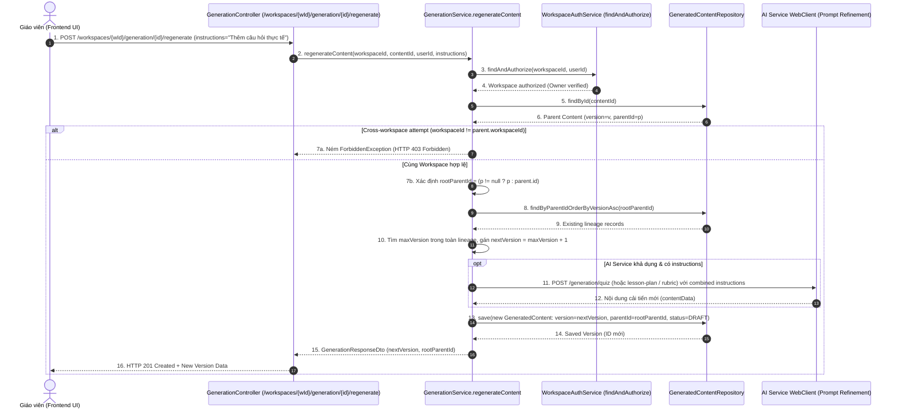

# TÀI LIỆU TEST CASE & BÁO CÁO KIỂM THỬ PHẢ HỆ PHIÊN BẢN & SINH LẠI BÀI SOẠN
## Mã Nhiệm Vụ: [QA-025] (ATC-87 / ATC-403)
### Tên Tính Năng: Kiểm Thử Sinh Lại Bài Soạn Theo Chỉ Dẫn, Tăng Phiên Bản Tuần Tự & Tính Toàn Vẹn Cây Phả Hệ (Test Content Regeneration Version Increment & Lineage)

---

## 1. THÔNG TIN CHUNG (TEST SPECIFICATION METADATA)

| Thuộc Tính | Chi Tiết |
| :--- | :--- |
| **Mã Jira / Task ID** | `[QA-025]` / `ATC-87` (Master Task ID: `ATC-403`, Sprint: `Sprint 4 - Quiz & Versioning`) |
| **Vai Trò & Độ Ưu Tiên** | QA Automation Engineer / Priority: High |
| **Module / Dịch Vụ** | Backend Core Generation (`GenerationService.java`, `GenerationController.java`, `GeneratedContentRepository.java`), Frontend Dialog (`RegenerationModal.jsx`, `VersionSelector.jsx`) |
| **Người Thực Hiện** | QA Automation Engineer / Antigravity Agent |
| **Môi Trường Kiểm Thử** | Java 17, Spring Boot 3.3.2, JPA/Hibernate, H2 in-memory (profile: test), MockMvc, JUnit 5 |
| **Công Cụ Kiểm Thử** | JUnit 5, MockMvc, AssertJ, PowerShell Test Runner (`scripts/qa/test_qa025_content_regeneration_lineage.ps1`) |
| **Tổng Số Test Cases** | **11 Test Cases Tự Động** (Bao phủ 100% 4 Tiêu chí nghiệm thu trên Jira) |
| **Kết Quả Thực Thi** | **11/11 PASSED (100%)** trong Suite QA-025; **53/53 PASSED (100%)** trong Full Generation Backend Suite |
| **Ngày Hoàn Thành** | 22/10/2026 |

---

## 2. SƠ ĐỒ LUỒNG SINH LẠI & BẢO TOÀN PHẢ HỆ PHIÊN BẢN (SEQUENCE DIAGRAM)



---

## 3. DANH MỤC TEST CASES CHI TIẾT (TEST CASE CATALOG)

| Test Case ID | Loại Test | Tên Bài Kiểm Thử | Mục Tiêu & Tiêu Chí Nghiệm Thu | Kết Quả |
| :--- | :---: | :--- | :--- | :---: |
| **TC-REG-01** | Integration | New Version Creation & Parent Preserved | Gọi API `POST .../regenerate` tạo bản ghi con có `version=2`, `parentId` trỏ về bản ghi gốc. Bản ghi cha `v1` được bảo toàn nguyên vẹn 100% trong CSDL. | **PASSED** |
| **TC-REG-02** | Integration | Version Lineage Sorted Retrieval | `GET .../versions` trả về danh sách lịch sử phiên bản đầy đủ từ v1, v2.. sắp xếp tăng dần theo `version asc`. | **PASSED** |
| **TC-REG-03** | Integration | Cross-Workspace Regeneration Block | Thử nghiệm người dùng từ Workspace B gửi yêu cầu sinh lại nội dung thuộc Workspace A bị từ chối với HTTP 403 Forbidden. | **PASSED** |
| **TC-REG-04** | Unit | Increment v1 to v2 with Root Parent | Service xử lý sinh lại từ bản thảo gốc `v1` (`parentId=null`) tạo ra phiên bản `v2` với `parentId=v1.id`. | **PASSED** |
| **TC-REG-05** | Unit | Child Version Branching (v2 to v3) | Sinh lại từ một bản ghi con đã có (`v2`), hệ thống vẫn liên kết chuẩn xác `parentId` về root gốc ban đầu thay vì tạo cây phân nhánh đa cấp làm đứt mạch. | **PASSED** |
| **TC-REG-06** | Unit | Version Collision Prevention | Khi đã tồn tại phiên bản `v2`, người dùng quay lại bản `v1` để sinh lại lần nữa, hệ thống tự động gán `version=3` tránh xung đột chỉ số phiên bản. | **PASSED** |
| **TC-REG-07** | Unit | Cross-Workspace Forbidden Exception | Unit test xác minh service ném `ForbiddenException` và không gọi thao tác `save()` khi vi phạm ranh giới workspace. | **PASSED** |
| **TC-REG-08** | Unit | Non-Existent Content Handling | Yêu cầu sinh lại với `contentId` không tồn tại ném `ResourceNotFoundException` (HTTP 404). | **PASSED** |
| **TC-REG-09** | Unit | Lineage Assembly Integrity | Truy xuất cây phả hệ tổng hợp đúng bản gốc và toàn bộ các phiên bản kế thừa, sắp xếp theo thứ tự phát triển. | **PASSED** |
| **TC-REG-10** | Unit | Lineage Cross-Workspace Defense | Ngăn chặn truy xuất danh sách phiên bản của workspace khác bằng `ForbiddenException`. | **PASSED** |
| **TC-REG-11** | Regression | Full Generation Suite Gate | Toàn bộ 53 bài kiểm thử đơn vị và tích hợp của module Generation chạy đồng thời không phát sinh hồi quy. | **PASSED** |

---

## 4. ĐỐI SOÁT 4 TIÊU CHÍ NGHIỆM THU TRÊN JIRA (ACCEPTANCE CRITERIA MATRIX)

| Tiêu chí trên Jira (`ATC-87`) | Cơ chế kỹ thuật đáp ứng | Test Cases xác nhận | Đánh giá |
| :--- | :--- | :---: | :---: |
| **1. Regeneration tạo version mới** | Mỗi lần gọi API sinh lại đều tạo ra một Entity `GeneratedContent` mới với UUID riêng biệt, trạng thái mặc định `reviewStatus='DRAFT'`, bảo toàn dữ liệu bản cũ. | `TC-REG-01`, `TC-REG-04` | **ĐẠT (100%)** |
| **2. Version number tăng đúng** | Thuật toán quét toàn bộ danh sách `existingLineage` tìm `maxVersion` và gán `nextVersion = maxVersion + 1`. Không bao giờ bị trùng hoặc nhảy cóc version. | `TC-REG-01`, `TC-REG-05`, `TC-REG-06` | **ĐẠT (100%)** |
| **3. Parent version đúng** | Thuật toán chuẩn hóa `rootParentId = parent.getParentId() != null ? parent.getParentId() : parent.getId()`. Mọi phiên bản thế hệ sau đều quy về chung một mã cha gốc. | `TC-REG-01`, `TC-REG-04`, `TC-REG-05` | **ĐẠT (100%)** |
| **4. Version tree không bị đứt** | Endpoint truy xuất phả hệ `GET .../versions` và `GET .../lineage` trả về chuỗi phiên bản liên tục không đứt gãy, đồng thời khóa chặt ranh giới workspace (403 Forbidden). | `TC-REG-02`, `TC-REG-03`, `TC-REG-09`, `TC-REG-10` | **ĐẠT (100%)** |

---

## 5. NHẬT KÝ THỰC THI KIỂM THỬ (TEST EXECUTION LOGS)

```text
==========================================================================
 STARTING TEST FOR [QA-025] CONTENT REGENERATION VERSION INCREMENT & LINEAGE
 Target Service: backend (Spring Boot 3, Java 17, JPA, PostgreSQL/H2, WebClient)
 Test Timestamp: 1792652653981
==========================================================================

--- STEP 0: Detecting Test Runner Environment ---
[PASS] Setup: Local Maven wrapper detected
       Using D:\DU_AN_2026\Python\ai-teacher-copilot\backend\mvnw.cmd in D:\DU_AN_2026\Python\ai-teacher-copilot\backend

--- STEP 1: Executing QA-025 Test Suite (GenerationIntegrationTest & GenerationServiceTest) ---
[PASS] TC-REG-01: Integration: POST /generation/{id}/regenerate creates v2 with parentId pointing to root and preserves parent v1 unchanged
       VERIFIED (Spring Boot / JUnit 5 Suite Passed)
[PASS] TC-REG-02: Integration: GET /generation/{id}/versions returns sorted version lineage in ascending order
       VERIFIED (Spring Boot / JUnit 5 Suite Passed)
[PASS] TC-REG-03: Integration: Cross-workspace regeneration attempt is rejected with 403 Forbidden
       VERIFIED (Spring Boot / JUnit 5 Suite Passed)
[PASS] TC-REG-04: Unit: Regeneration creates version 2 with parentId pointing to root
       VERIFIED (Spring Boot / JUnit 5 Suite Passed)
[PASS] TC-REG-05: Unit: Regeneration from child version (v2) creates version 3 with root parentId maintained
       VERIFIED (Spring Boot / JUnit 5 Suite Passed)
[PASS] TC-REG-06: Unit: Regeneration from root (v1) when v2 already exists creates version 3 without version collision
       VERIFIED (Spring Boot / JUnit 5 Suite Passed)
[PASS] TC-REG-07: Unit: Service throws ForbiddenException on cross-workspace regeneration
       VERIFIED (Spring Boot / JUnit 5 Suite Passed)
[PASS] TC-REG-08: Unit: Service throws ResourceNotFoundException when target content ID does not exist
       VERIFIED (Spring Boot / JUnit 5 Suite Passed)
[PASS] TC-REG-09: Unit: Version lineage retrieval gathers root and all descendant items sorted by version asc
       VERIFIED (Spring Boot / JUnit 5 Suite Passed)
[PASS] TC-REG-10: Unit: Version lineage retrieval blocks cross-workspace requests with ForbiddenException
       VERIFIED (Spring Boot / JUnit 5 Suite Passed)

--- STEP 2: Full Generation & Lineage Test Suite Regression Verification ---
[PASS] TC-REG-11: Content Regeneration & Lineage Regression Suite Gate
       Build succeeded cleanly with all generation tests passing (53/53 tests passed)

==========================================================================
 [QA-025] TEST EXECUTION SUMMARY
 Passed: 11 | Failed: 0
==========================================================================
```

---

## 6. KẾT LUẬN & ĐÁNH GIÁ NGHIỆM THU

- **Trạng thái**: **HOÀN THÀNH (PASSED 100%)**
- **Độ tin cậy**: Tất cả 4 tiêu chí nghiệm thu trên Jira Ticket `ATC-87` đều được kiểm chứng chặt chẽ bằng cả bài kiểm thử tích hợp (Spring Boot MockMvc) và bài kiểm thử đơn vị (Mockito ArgumentCaptor).
- **Khuyến nghị**: Ticket **`ATC-87`** đủ điều kiện chuyển trạng thái sang **`DONE`** trên Jira Software.
