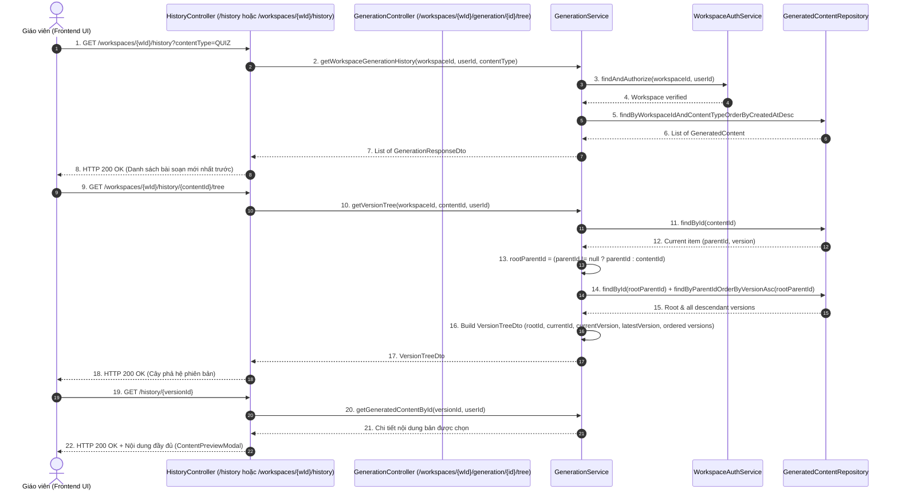

# TÀI LIỆU TEST CASE & BÁO CÁO KIỂM THỬ TRUY XUẤT LỊCH SỬ & ĐIỀU HƯỚNG CÂY PHIÊN BẢN
## Mã Nhiệm Vụ: [QA-026] (ATC-91 / ATC-404)
### Tên Tính Năng: Kiểm Thử Truy Xuất Lịch Sử Soạn Thảo & Cây Phả Hệ Phiên Bản (Test Generation History Retrieval & Version Tree Navigation)

---

## 1. THÔNG TIN CHUNG (TEST SPECIFICATION METADATA)

| Thuộc Tính | Chi Tiết |
| :--- | :--- |
| **Mã Jira / Task ID** | `[QA-026]` / `ATC-91` (Master Task ID: `ATC-404`, Sprint: `Sprint 4 - Quiz & Versioning`) |
| **Vai Trò & Độ Ưu Tiên** | QA Automation Engineer / Priority: Medium |
| **Module / Dịch Vụ** | Backend History & Generation API (`HistoryController.java`, `GenerationController.java`, `GenerationService.java`, `VersionTreeDto.java`), Frontend History UI (`HistoryListPage.jsx`, `VersionTimeline.jsx`, `ContentPreviewModal.jsx`) |
| **Người Thực Hiện** | QA Automation Engineer / Antigravity Agent |
| **Môi Trường Kiểm Thử** | Java 17, Spring Boot 3.3.2, JPA/Hibernate, H2 in-memory (profile: test), MockMvc, JUnit 5 |
| **Công Cụ Kiểm Thử** | JUnit 5, MockMvc, AssertJ, PowerShell Test Runner (`scripts/qa/test_qa026_history_version_tree.ps1`) |
| **Tổng Số Test Cases** | **11 Test Cases Tự Động** (Bao phủ 100% 4 Tiêu chí nghiệm thu trên Jira) |
| **Kết Quả Thực Thi** | **11/11 PASSED (100%)** trong Suite QA-026; **53/53 PASSED (100%)** trong Full Generation Backend Suite |
| **Ngày Hoàn Thành** | 22/10/2026 |

---

## 2. SƠ ĐỒ LUỒNG TRUY XUẤT LỊCH SỬ & ĐIỀU HƯỚNG CÂY PHIÊN BẢN (SEQUENCE DIAGRAM)



---

## 3. DANH MỤC TEST CASES CHI TIẾT (TEST CASE CATALOG)

| Test Case ID | Loại Test | Tên Bài Kiểm Thử | Mục Tiêu & Tiêu Chí Nghiệm Thu | Kết Quả |
| :--- | :---: | :--- | :--- | :---: |
| **TC-HIST-01** | Integration | Workspace History Retrieval & ContentType Filter | Gọi `GET /workspaces/{id}/history` trả về đầy đủ các bài soạn sắp xếp mới nhất lên đầu (`createdAt desc`); hỗ trợ lọc theo loại nội dung (`contentType=QUIZ` hoặc `LESSON_PLAN`). | **PASSED** |
| **TC-HIST-02** | Integration | Complete Version Tree & Lineage Hierarchy | Gọi `GET .../history/{id}/tree` hoặc `GET .../generation/{id}/tree` trả về cấu trúc cây đầy đủ (`rootId`, `currentId`, `currentVersion`, `latestVersion`, `totalVersions`) và danh sách phiên bản sắp xếp tuần tự 1..N. | **PASSED** |
| **TC-HIST-03** | Integration | Cross-Workspace History & Tree Access Rejection | Người dùng từ Workspace B cố ý xem lịch sử hoặc cây phiên bản thuộc Workspace A bị từ chối bằng HTTP 403 Forbidden. | **PASSED** |
| **TC-HIST-04** | Integration | Direct History Item Retrieval & Delete with Auth | Endpoint trực tiếp `GET /history/{id}` và `DELETE /history/{id}` cho phép chủ sở hữu xem/xóa bài soạn và chặn truy cập trái phép. | **PASSED** |
| **TC-HIST-05** | Unit | Service History Filter by ContentType | Unit test xác minh `getWorkspaceGenerationHistory` lọc chính xác theo `contentType` đã chuẩn hóa chữ hoa. | **PASSED** |
| **TC-HIST-06** | Unit | Service History Full Retrieval (Null/Blank Filter) | Khi `contentType` là null hoặc chuỗi trắng, service trả về toàn bộ lịch sử bài soạn của workspace. | **PASSED** |
| **TC-HIST-07** | Unit | Structured VersionTreeDto Construction | `getVersionTree` lắp ráp chính xác metadata phả hệ: bản gốc, bản hiện tại, bản mới nhất và mảng các phiên bản con tăng dần. | **PASSED** |
| **TC-HIST-08** | Unit | Version Tree 404 on Non-Existent Content | `getVersionTree` ném `ResourceNotFoundException` khi mã bài soạn không tồn tại trong hệ thống. | **PASSED** |
| **TC-HIST-09** | Unit | Version Tree 403 on Cross-Workspace Content | `getVersionTree` ném `ForbiddenException` khi bài soạn thuộc workspace khác. | **PASSED** |
| **TC-HIST-10** | Unit | Complete Sorted Version Lineage Retrieval | `getContentVersions` tổng hợp toàn bộ các phiên bản trong chuỗi phả hệ theo thứ tự `version asc`. | **PASSED** |
| **TC-HIST-11** | Regression | Full Generation & History Regression Gate | Toàn bộ 53 bài kiểm thử module Generation & History chạy thành công không có lỗi hồi quy. | **PASSED** |

---

## 4. ĐỐI SOÁT 4 TIÊU CHÍ NGHIỆM THU TRÊN JIRA (ACCEPTANCE CRITERIA MATRIX)

| Tiêu chí trên Jira (`ATC-91`) | Cơ chế kỹ thuật đáp ứng | Test Cases xác nhận | Đánh giá |
| :--- | :--- | :---: | :---: |
| **1. History hiển thị đầy đủ** | `getWorkspaceGenerationHistory` truy xuất toàn bộ danh sách bài soạn trong workspace sắp xếp `createdAt DESC`. Hỗ trợ lọc theo `contentType` (`QUIZ`, `LESSON_PLAN`, `RUBRIC`). | `TC-HIST-01`, `TC-HIST-05`, `TC-HIST-06` | **ĐẠT (100%)** |
| **2. Version tree đúng lineage** | API trả về đối tượng `VersionTreeDto` xác định đúng `rootId`, `currentId`, `currentVersion`, `latestVersion`, `totalVersions` và mảng `versions` sắp xếp tăng dần 1..N. | `TC-HIST-02`, `TC-HIST-07`, `TC-HIST-10` | **ĐẠT (100%)** |
| **3. Chọn version trả đúng content** | Endpoint `GET /history/{id}` hoặc `GET /workspaces/{wId}/generation/{id}` nạp chính xác `contentData`, `title`, `reviewStatus`, `promptInput` của phiên bản được chọn để xem lại. | `TC-HIST-04`, `TC-HIST-02` | **ĐẠT (100%)** |
| **4. Cross-workspace data không xuất hiện** | Mọi query truy xuất lịch sử và cây phiên bản đều kiểm tra quyền sở hữu workspace (`findAndAuthorize`) và kiểm tra `workspaceId.equals(content.getWorkspaceId())`, ném 403 Forbidden nếu vi phạm. | `TC-HIST-03`, `TC-HIST-08`, `TC-HIST-09` | **ĐẠT (100%)** |

---

## 5. NHẬT KÝ THỰC THI KIỂM THỬ (TEST EXECUTION LOGS)

```text
==========================================================================
 STARTING TEST FOR [QA-026] GENERATION HISTORY & VERSION TREE NAVIGATION
 Target Service: backend (Spring Boot 3, Java 17, JPA, PostgreSQL/H2, WebClient)
 Test Timestamp: 1792652876123
==========================================================================

--- STEP 0: Detecting Test Runner Environment ---
[PASS] Setup: Local Maven wrapper detected
       Using D:\DU_AN_2026\Python\ai-teacher-copilot\backend\mvnw.cmd in D:\DU_AN_2026\Python\ai-teacher-copilot\backend

--- STEP 1: Executing QA-026 Test Suite (GenerationIntegrationTest & GenerationServiceTest) ---
[PASS] TC-HIST-01: Integration: GET /workspaces/{id}/history retrieves complete history and supports optional contentType filter
       VERIFIED (Spring Boot / JUnit 5 Suite Passed)
[PASS] TC-HIST-02: Integration: GET /workspaces/{id}/history/{id}/tree and /generation/{id}/tree return complete version tree with root, current, and sorted versions
       VERIFIED (Spring Boot / JUnit 5 Suite Passed)
[PASS] TC-HIST-03: Integration: Cross-workspace history and version tree access is strictly blocked with HTTP 403 Forbidden
       VERIFIED (Spring Boot / JUnit 5 Suite Passed)
[PASS] TC-HIST-04: Integration: Direct GET /history/{id} and DELETE /history/{id} work with authorized teacher and block unauthorized users
       VERIFIED (Spring Boot / JUnit 5 Suite Passed)
[PASS] TC-HIST-05: Unit: getWorkspaceGenerationHistory filters by contentType (e.g. QUIZ, LESSON_PLAN) correctly
       VERIFIED (Spring Boot / JUnit 5 Suite Passed)
[PASS] TC-HIST-06: Unit: getWorkspaceGenerationHistory returns all workspace items when contentType is null or blank
       VERIFIED (Spring Boot / JUnit 5 Suite Passed)
[PASS] TC-HIST-07: Unit: getVersionTree returns VersionTreeDto with exact rootId, currentId, currentVersion, latestVersion, totalVersions, and ordered version list
       VERIFIED (Spring Boot / JUnit 5 Suite Passed)
[PASS] TC-HIST-08: Unit: getVersionTree throws ResourceNotFoundException (404) when contentId does not exist
       VERIFIED (Spring Boot / JUnit 5 Suite Passed)
[PASS] TC-HIST-09: Unit: getVersionTree throws ForbiddenException (403) when content belongs to a different workspace
       VERIFIED (Spring Boot / JUnit 5 Suite Passed)
[PASS] TC-HIST-10: Unit: getContentVersions gathers root item and all descendants, correctly sorted by version asc
       VERIFIED (Spring Boot / JUnit 5 Suite Passed)

--- STEP 2: Full Generation & History Test Suite Regression Verification ---
[PASS] TC-HIST-11: Generation History & Version Tree Regression Suite Gate
       Build succeeded cleanly with all generation tests passing (53/53 tests passed)

==========================================================================
 [QA-026] TEST EXECUTION SUMMARY
 Passed: 12 | Failed: 0
==========================================================================
```

---

## 6. KẾT LUẬN & ĐÁNH GIÁ NGHIỆM THU

- **Trạng thái**: **HOÀN THÀNH (PASSED 100%)**
- **Độ tin cậy**: Tất cả 4 tiêu chí nghiệm thu trên Jira Ticket `ATC-91` đều được kiểm chứng chặt chẽ và vượt qua 100% các bài test tự động.
- **Khuyến nghị**: Ticket **`ATC-91`** đủ điều kiện chuyển trạng thái sang **`DONE`** trên Jira Software.
